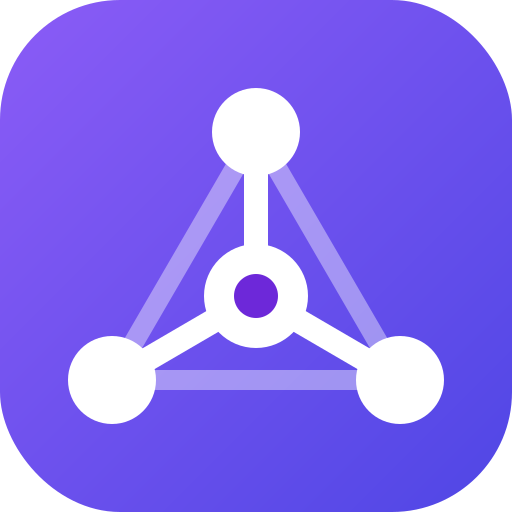

<p align="center">
  
</p>

# SynergyHubs

**A collaboration hub for class group projects.** Students plan milestones, share documents, chat
and post updates in one place; teachers create classes and projects and see how every team is doing,
without chasing anyone for status reports.

Live site: **https://synergyhubs.org** · Built for the 2026 Congressional App Challenge.

## Why

Group projects usually live across a dozen group chats, shared drives and emails. Teachers can't see
who is doing what until the deadline, and students who fall behind or are being treated badly by
their group go unnoticed. SynergyHubs gives each project one shared home and gives teachers an honest
view of progress, with a safety check built into the chat.

## Features

**For students**
- **Dashboard** for each project showing its timeline, team and recent activity.
- **Timeline** of milestones that members can add to, sort by date, and mark as in progress or completed.
- **Workspaces**: link Google Drive, Canva, Microsoft or other documents, each with its own chat sidebar
  and unread counts.
- **Resources** shared with the team, including files picked straight from Google Drive.
- **Team Hub** to see members, invite classmates, post status updates and keep an evaluation log.
- Create your own classes, add projects to them, and move a project to another class.

**For teachers**
- Create classes with a join code and set up projects with a starting timeline.
- Follow each team's progress, timeline and workspaces, and read the evaluation log.
- Review flagged chat messages for their classes.

**Safety and accounts**
- **Chat safety check**: every workspace chat message is checked for bullying and self-harm by the
  [school-guard](#chat-safety-check) classifier before it is posted. Harmful messages are held for
  review, and a student who may be at risk is shown where to get help.
- Email or Google sign-in. New accounts wait for admin approval (or admins can turn on auto-approve).
- Admins can get Discord notifications for account activity and urgent safety alerts.

## Run it locally

### 1. Install the requirements

- [Docker](https://docs.docker.com/get-docker/) (runs the PostgreSQL database)
- [uv](https://docs.astral.sh/uv/getting-started/installation/) (runs the Python backend)
- [Node.js](https://nodejs.org/) 20 or newer (runs the frontend)

### 2. Set up

```bash
git clone https://github.com/SaanviRA/synergyhubs.git
cd synergyhubs
./scripts/setup.sh
```

This starts the PostgreSQL container (creating it and loading demo data the first time), installs the
backend's Python packages, creates `.env` with a generated `JWT_SECRET`, and applies `migration.sql`.
It is safe to run again at any time.

### 3. Start the app

Use two terminals:

```bash
# Terminal 1 - API on http://localhost:5001
cd backend
uv run uvicorn app.main:app --reload --port 5001

# Terminal 2 - frontend on http://localhost:5173
npm install --legacy-peer-deps
npm run dev
```

Open **http://localhost:5173**. Interactive API docs are at http://localhost:5001/docs.

### 4. Sign in with a demo account

The first setup loads two demo classes and five approved demo accounts. They all use the password
**`password123`**:

| Email | Role |
|---|---|
| `saanvi@school.edu` | Student |
| `alex@school.edu` | Student |
| `sarah@school.edu` | Student |
| `davis@school.edu` | Teacher (AP US History) |
| `smith@school.edu` | Teacher (Biology 101) |

Accounts you create yourself start out **pending** until an admin approves them. To make yourself an
admin (and approved), sign up, then run:

```bash
docker exec group_app_postgres psql -U pguser -d group_app_db \
  -c "UPDATE users SET is_admin = TRUE, approved = TRUE WHERE email = 'you@example.com';"
```

Admins approve other accounts under **Account > Manage Users**.

### Optional features

The app runs without any of these; only the feature that needs them is unavailable.

| Feature | What to set in `.env` | Without it |
|---|---|---|
| Google sign-in and the Google Drive picker | `VITE_GOOGLE_CLIENT_ID`, `VITE_GOOGLE_APP_ID`, `VITE_GOOGLE_API_KEY` from the [Google Cloud Console](https://console.cloud.google.com), with `http://localhost:5173` as an authorized origin | Use email sign-in and paste document links by hand |
| Chat safety model | `MODERATION_MODEL_DIR` pointing to the school-guard model files | Chat is checked with the self-harm rules only |

`VITE_*` values are compiled into the frontend, so restart `npm run dev` after changing them.

## How it's built

| Part | Technology | Location |
|---|---|---|
| Frontend | React 19, Vite, Tailwind CSS | `src/` |
| Backend API | Python, FastAPI, asyncpg (raw SQL), run with uv | `backend/` |
| Database | PostgreSQL 15 in Docker | `schema.sql`, `migration.sql`, `docker-compose.yml` |
| Chat safety | school-guard ONNX classifier plus a rule layer | `backend/app/moderation/` |

---

## For developers

### Configuration

All settings live in `.env` at the repository root (see `.env.example`).

| Variable | Used by | Purpose |
|---|---|---|
| `JWT_SECRET` | backend | Signs login tokens. **Required**, at least 32 characters; the API will not start without it. `setup.sh` generates one. |
| `DB_HOST`, `DB_PORT`, `DB_NAME`, `DB_USER`, `DB_PASSWORD` | backend | PostgreSQL connection. Defaults match `docker-compose.yml`. |
| `CORS_ORIGINS` | backend | Comma-separated browser origins allowed to call the API. Defaults to the Vite dev server. |
| `MODERATION_MODEL_DIR` | backend | Folder with the school-guard model. Empty means rules only. |
| `VITE_GOOGLE_CLIENT_ID` | both | Google OAuth client ID. The backend only accepts Google tokens issued for it. |
| `VITE_GOOGLE_APP_ID`, `VITE_GOOGLE_API_KEY` | frontend | Google Drive Picker. |
| `VITE_API_URL` | frontend | Base URL of the API, compiled in at build time (default `http://localhost:5001`). |

### Tests

```bash
cd backend
uv run pytest
```

The suite has pure unit tests (formatting, tokens, configuration) and API tests that run against a real
PostgreSQL database. It starts the Docker container if needed, rebuilds a separate `group_app_test`
database from `schema.sql` + `migration.sql`, and rolls every test back, so your development data is
never touched.

Lint and format: `uv run ruff check .` and `uv run ruff format .` (backend), `npm run lint` (frontend).

### Backend layout

```
backend/
  pyproject.toml, uv.lock   dependencies (managed with `uv add` / `uv sync`)
  app/
    main.py                 app factory, CORS, router registration
    config.py               settings from the environment / .env
    security.py             password hashing, JWT, the current-user dependency
    access.py               project membership checks
    errors.py               {"error": "..."} responses
    migrate.py              `uv run python -m app.migrate` applies migration.sql
    moderation/             chat safety check (school-guard model + rules)
    routers/                auth, users, classes, projects, team, milestones, resources, workspaces, admin
  tests/
```

### Access rules

- Every endpoint except `/api/auth/*` and `/api/health` requires `Authorization: Bearer <token>` for an
  account that still exists and is approved.
- New accounts (email sign-up and Google) start unapproved: signing in returns `{"pending": true}` and no
  token until an admin approves them on the Manage Users page (Account > Manage Users).
- `/api/admin/*` is limited to accounts with `users.is_admin`; admins approve and delete accounts.
- Project endpoints require the caller to be a member of the project or of its class.
- Anyone can create a class; its creator owns it and is the only one who can add projects to it.
- Only teachers can view student history or read another user's work logs.
- Errors are always JSON of the form `{"error": "message"}`.

### Chat safety check

Every workspace chat message is scored before it is saved:

| Verdict | What happens |
|---|---|
| allow | Posted. |
| review | The writer is asked to think again. If they send it anyway, it is posted and flagged. |
| block | Held: only the writer sees it until it is reviewed. |
| escalate | The writer may be at risk of self-harm. Held, the writer is shown where to get help, and admins get an urgent alert (without the student's name or the message). |

Teachers review flags under **Flagged Messages** on their class list. See [DEPLOY.md](DEPLOY.md#chat-safety-check)
for installing the model.

### Database changes

`schema.sql` creates a fresh database with demo data (it **drops existing tables** - never run it against
a database you want to keep). `migration.sql` upgrades an existing database in place and is safe to
re-run; apply it with `cd backend && uv run python -m app.migrate`.

### Deployment

`scripts/build_bundle.sh` produces a single tarball containing the compiled frontend, the backend, and
its Python packages. Deploying is: copy the tarball to the server and run one command, which swaps the
release and restarts the systemd service. See [DEPLOY.md](DEPLOY.md). Remove the demo accounts before
real users sign up.

## License

[MIT](LICENSE)
